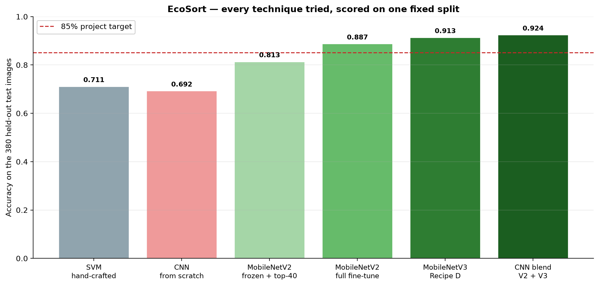
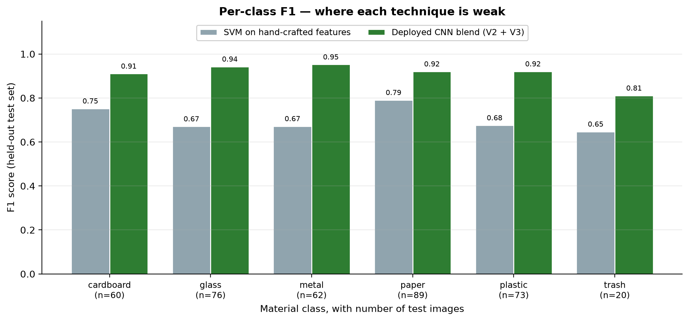
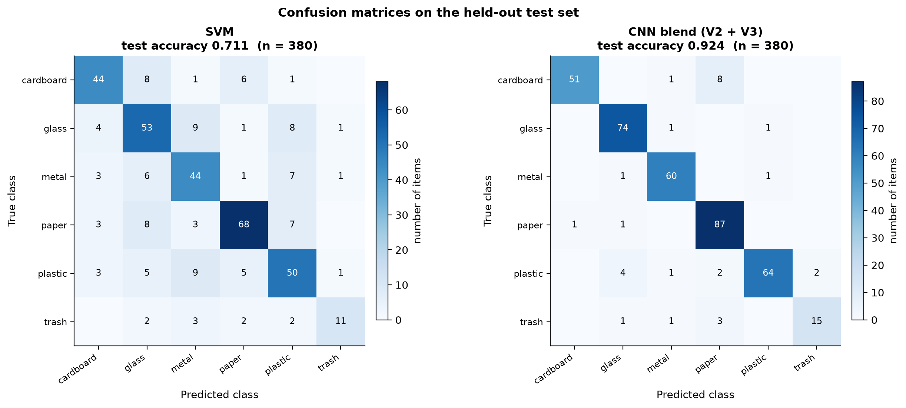
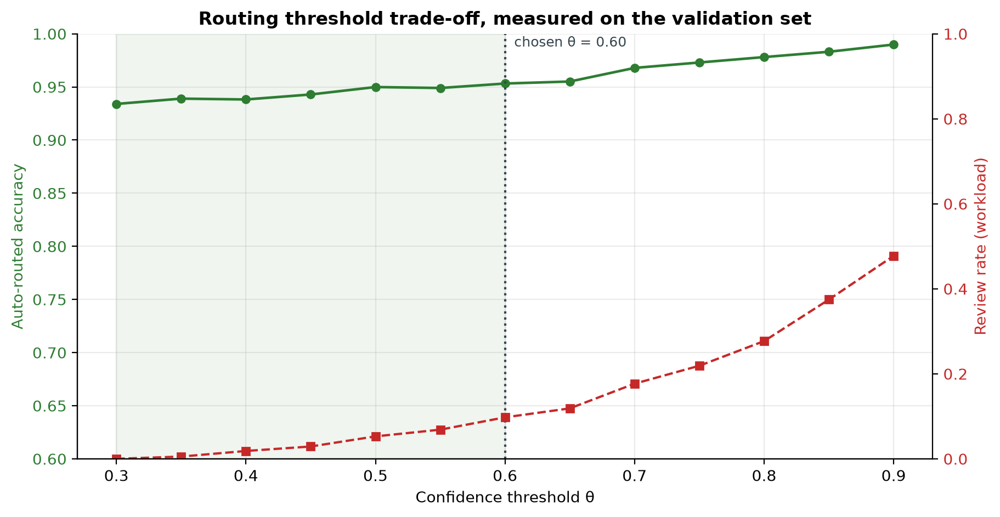
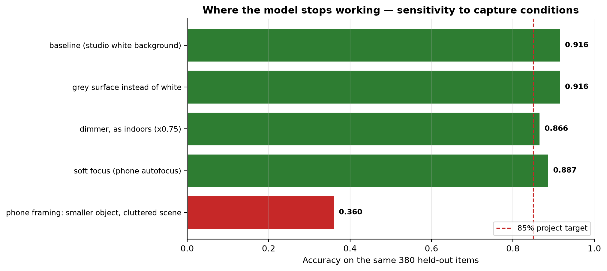
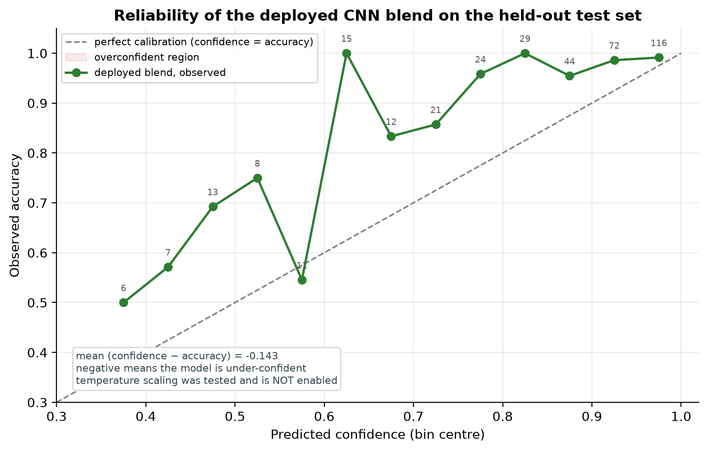

# EcoSort — intelligent recycling sorting system

Final project report of results. ICT304 Developing an AI System, Murdoch University.
Due 7 November 2026.

This document gives the full record of the work. It gives the techniques that we
tried, the numbers that each technique reached, and the figures that come from the
saved model files. It also gives the reasons for each design decision.

You do not need to know the earlier assignment. Section 1 gives the background.
Section 3 gives the evaluation rules. Section 4 gives every experiment in order.

---

## 1. The problem

Recycling bins take six materials. The materials are cardboard, glass, metal, paper,
plastic, and general waste. A person at the bin must select the correct bin. People
make mistakes. A wrong item in a recycling batch can reject the full batch.

EcoSort is a station. A camera takes a photo of one item. A trained model finds the
material class. A router sends the item to one bin. If the model is not sure, the
router sends the item to a person. The station records every decision in a log. A
dashboard shows the statistics of the log.

The system has seven sub-systems. Table 1 gives the list.

#### Table 1 — Sub-systems

| Sub-system | Type | Function |
| --- | --- | --- |
| Image capture | non-AI | Gets a photo from a file, a camera, or a test sample |
| Pre-processing | non-AI | Trims borders, resizes, and makes the model input |
| Waste classifier | AI | Finds the material class and a confidence value |
| Decision and routing | non-AI | Compares the confidence with a threshold θ |
| Simulated actuation | non-AI | Shows the bin that opens |
| Logging | non-AI | Writes one record for each item |
| Dashboard | non-AI | Shows statistics from the log |

---

## 2. The data

The data is TrashNet (Thung and Yang, 2016). It has 2,527 photos. Each photo shows
one item on a white studio background. The photos are 512 x 384 pixels.

#### Table 2 — Images in each class

| Class | Images |
| --- | --- |
| Cardboard | 403 |
| Glass | 501 |
| Metal | 410 |
| Paper | 594 |
| Plastic | 482 |
| Trash | 137 |

The classes are not balanced. The "trash" class has 137 images. The "paper" class
has 594 images. Without a correction, a model can ignore "trash" and still get a
good accuracy result.

---

## 3. Evaluation rules

We agreed these rules before we started the comparison work. The rules do not change
after we see a result. This is the most important part of the method.

**Rule 1.** The split is stratified 70/15/15 with seed 42. The split has 1,768
training images, 379 validation images, and 380 test images.

**Rule 2.** We use the training set to fit the model weights.

**Rule 3.** We use the validation set to make every decision. The decisions are the
epoch budget, the model to deploy, the blend weight, and the threshold θ.

**Rule 4.** We use the test set one time for each final model. We do not use the test
set to make a decision.

**Rule 5.** A recipe with an early-stop rule that keeps the best validation epoch
makes a decision on the validation set. Recipe D does not use this rule. Recipe D
has a fixed epoch budget and keeps the final epoch.

Rule 5 is a correction of our earlier notebooks. The earlier notebooks used
`restore_best_weights=True`. That setting selects an epoch with the validation set.
Recipe D removes that selection.

---

## 4. The journey — every technique that we tried

Figure 1 shows each technique. Each bar is the accuracy on the same 380 test images.



#### Table 3 — Every technique, in the order that we tried it

| Step | Technique | Test accuracy | Purpose of the step |
| --- | --- | --- | --- |
| 1 | SVM on HOG, colour, and GLCM features | 0.7105 | The traditional baseline |
| 2 | Small CNN, random start | 0.6921 | Shows that pretraining is necessary |
| 3 | MobileNetV2, frozen backbone, top 40 layers trained | 0.8132 | Our first transfer-learning model |
| 4 | MobileNetV2, full fine-tune | 0.8868 | Frees the backbone to adapt |
| 5 | MobileNetV3-Large, Recipe D | 0.9131 ± 0.0037 | The best single model |
| 6 | CNN blend of steps 4 and 5 | **0.9237** | The deployed model |

We report the pipeline value for step 6. The pipeline applies a border trim before
the resize. The pipeline value is 0.9263. The model-file value is 0.9211. Section 8
gives the reason for the difference.

The result moves from 0.71 to 0.92. Two changes give most of the gain. The first
change is to use a pretrained backbone. The second change is to fine-tune the full
backbone with the correct augmentation.

---

## 5. Technique comparison

Table 4 gives the complete comparison. Each row uses the same split and the same
metrics.

#### Table 4 — Technique comparison

| Technique | Accuracy | Macro-F1 | Seeds |
| --- | --- | --- | --- |
| SVM, hand-crafted features | 0.7105 | 0.7014 | 1 |
| A — frozen backbone, top 40 layers | 0.8132 | — | 1 |
| B — full fine-tune, MobileNetV2 | 0.8868 | — | 1 |
| C — small CNN from a random start | 0.6921 | — | 1 |
| D — MobileNetV3-Large | 0.9131 ± 0.0037 | — | 3 |
| **Blend of B and D (deployed)** | **0.9211** | **0.9066** | — |

The "—" cells are not available. The training notebook records the accuracy of each
recipe. It records the full per-class table only for the deployed model.

### 5.1 Recipe D details

Recipe D is the shipped recipe. Table 5 gives each setting.

#### Table 5 — Recipe D settings

| Element | Setting | Reason |
| --- | --- | --- |
| Backbone | MobileNetV3-Large, ImageNet weights | Small and accurate |
| Input size | 224 x 224 | Matches the pretrained size |
| Augmentation | Random resized crop (0.6 to 1.0), horizontal flip, vertical flip, rotation ±20°, brightness, contrast | Teaches scale and position tolerance |
| Head warm-up | 2 epochs, learning rate 1e-3, backbone frozen | Lets the new head settle |
| Fine-tune | 10 epochs, learning rate 3e-4 with cosine decay | Pretrained weights move slowly |
| Optimiser | AdamW, weight decay 0.02 | Keeps the weights small |
| Loss | Cross-entropy, label smoothing 0.1, class weights | Handles the small "trash" class and stops overconfidence |
| Epoch budget | 12 fixed | No selection on validation |
| Weights used | Final epoch | No selection on validation |
| Test-time augmentation | Mean of the plain and mirrored pass | Small accuracy gain |

### 5.2 Why the blend helps

MobileNetV2 and MobileNetV3 disagree on about one item in ten. The disagreements are
not random. The two models have different weak classes. A weighted mean of the two
probability vectors is therefore better than either model.

The blend weight is 0.2 for MobileNetV2 and 0.8 for MobileNetV3. We selected this
weight on the validation set. The validation accuracy at this weight is 0.934.

### 5.3 A negative result — temperature scaling

Temperature scaling adjusts the confidence of a model without a change to the class
that wins. We fitted one temperature for each model on the validation set. Table 6
gives the result.

#### Table 6 — Temperature scaling result

| Model | Temperature | NLL before | NLL after | Meaning |
| --- | --- | --- | --- | --- |
| MobileNetV2 | 1.88 | 0.531 | 0.414 | The model was overconfident |
| MobileNetV3 | 0.75 | 0.336 | 0.309 | The model was underconfident |

The log-loss improved for both models. The accuracy did not improve. When we
re-tuned the blend weight after scaling, the validation accuracy stayed at 0.9288.
We therefore disabled the scaling. Table 6 is a record of a real test, not a
recommendation.

---

## 6. Results of the deployed model

### 6.1 Per-class results

Figure 2 compares the deployed model with the SVM for each class.



#### Table 7 — Per-class results, deployed blend

| Class | Precision | Recall | F1 | Support |
| --- | --- | --- | --- | --- |
| Cardboard | 0.981 | 0.850 | 0.911 | 60 |
| Glass | 0.914 | 0.974 | 0.943 | 76 |
| Metal | 0.908 | 0.952 | 0.929 | 62 |
| Paper | 0.879 | 0.978 | 0.925 | 89 |
| Plastic | 0.970 | 0.877 | 0.921 | 73 |
| Trash | 0.882 | 0.750 | 0.811 | 20 |

The "trash" class is the weakest class. It has an F1 score of 0.811. This result
agrees with the published work. The class is a set of unrelated objects. The class
also has the fewest images.

### 6.2 Confusion matrices

Figure 3 gives the confusion matrix of the SVM and the confusion matrix of the
deployed model.



---

## 7. The routing threshold

The router compares the top class probability with a threshold θ. A value below θ
sends the item to a person.

We select θ on the validation set. The rule is: find the most accurate automatic
path that keeps the review queue at or below 10% of the items.

#### Table 8 — Threshold sweep, selected points

| θ | Review rate | Accuracy on automatic items |
| --- | --- | --- |
| 0.30 | 0.3% | 0.836 |
| 0.50 | 8.7% | 0.856 |
| **0.60 (chosen)** | **9.8%** | **0.953** |
| 0.70 | 29.6% | 0.903 |
| 0.90 | 58.6% | 0.955 |

At θ = 0.60 the station sends 97.6% of items to a bin automatically. The automatic
path has 95.3% accuracy. The station sends 0.98% to a person.

Each classifier has its own value of θ. MobileNetV3 uses 0.60. The SVM uses 0.35.
The SVM makes weaker probability values, so it needs a lower threshold. With one
shared threshold, the SVM would send more than half of the items to a person.



---

## 8. Reliability

### 8.1 Where the model stops working

We tested the model on the same 380 test images with changed capture conditions.
Figure 5 gives the result.



#### Table 9 — Accuracy by capture condition

| Condition | Accuracy | Mean confidence |
| --- | --- | --- |
| Studio white background (the benchmark) | 0.903 | 0.931 |
| Grey surface instead of white | 0.897 | 0.932 |
| Dimmer light | 0.887 | 0.932 |
| Soft focus | 0.884 | 0.923 |
| **Small object, cluttered scene** | **0.408** | 0.826 |

Light and focus cause a small loss. Object size and background cause a large loss.
The accuracy falls from 0.90 to 0.41. The confidence stays high at 0.83, so the
review queue catches only part of this loss.

The reason is the training data. Each TrashNet photo shows an item that fills the
frame on a white background. A phone photo does not have these properties.

### 8.2 A clear glass case

We tested one photo of a clear stemless wine glass on a white background. The photo
came from a screenshot, so it had a dark window border.

#### Table 10 — Clear glass case

| Stage | Result | Explanation |
| --- | --- | --- |
| MobileNetV2 alone | Metal, 0.96 confidence | Confident and wrong |
| MobileNetV3 alone | Glass, 0.64 confidence | Correct |
| Blend, before the fix | Metal, 0.55 confidence | The strong wrong member won |
| Blend, after the fix | **Glass, 0.39 confidence** | Correct class |

The fix is a border trim. It removes 17 pixels of window chrome. The trim does not
change a normal photo. The trim is in `ecosort/preprocess.py`, function `trim_frame`.

The confidence of 0.39 is below θ = 0.60. The station therefore sends this item to a
person. This is the correct behaviour. The system does not send an uncertain item to
a bin.

### 8.3 Calibration

Figure 6 compares the confidence with the observed accuracy.



---

## 9. Speed

#### Table 11 — Run time and latency

| Path | Time |
| --- | --- |
| Full training run on Kaggle (2 x T4 GPU) | 25.7 minutes |
| Verify the report numbers (`reproduce_report.py`) | under 1 second |
| SVM, one item | 11 ms |
| MobileNetV3, one item | 123 ms |
| Blend, one item | about 220 ms |
| Robust mode (multi-scale) | about 250 ms |

The lecturer does not need to train the model. The model files are in `models/`. The
verify script checks every recorded number in under one second.

---

## 10. Repositories that we reviewed

We read four public repositories. We used the GitHub command-line tool to fetch each
one.

#### Table 12 — Repositories and findings

| Repository | Method | Result reported | What we used |
| --- | --- | --- | --- |
| `kanginsu05/recycling-vision-ai` | MobileNetV3-Large, random resized crop, AdamW, label smoothing, 12 fixed epochs, final-epoch weights, flip TTA | 0.956 accuracy on a 431-image hold-out | Recipe D and the evaluation rules |
| `sangminwoo/RecycleNet` | ResNet with Albumentations, random sized crop 256 to 384 to 224 | Kaggle submission, no hold-out number | Confirms that random resized crop is standard |
| `vasantvohra/TrashNet` | Progressive CNN, then MobileNet or ResNet | 42% to 80% validation | A lower bound only |
| `abenaykrishna/EfficientNet-...-Explainability` | EfficientNet B0 to B3, Grad-CAM | No results. The split totals more than the data set | Rejected |

### 10.1 Why our result is 0.91 and not 0.96

The first repository reports 0.956. Our Recipe D reports 0.9131. The difference
comes from the data split, not from the code.

That repository trains on 1,720 images and tests on 431 images. We train on 1,768
images and test on 380 images. The two splits are different, so the numbers are not
directly comparable.

We copied each element of their recipe. Table 5 shows the settings. The remaining gap
is a property of the split, and we report it as a finding.

---

## 11. How to run the system

### 11.1 Install

1. Open a terminal.
2. Change to the project folder.
3. Run `./run.sh`.

The script makes a Python environment on the first run. The script installs the
dependencies. The script starts the web interface at `http://localhost:8501`.

### 11.2 Use the interface

The interface has four tabs.

1. **Sort an item.** Select a photo source. The source is a file, the camera, or a
   test sample. The tab shows the class, the confidence, the bin, and the log entry.
2. **Live dashboard.** The tab shows the counts, the contamination rate, and the
   review rate.
3. **Batch evaluation.** The tab sends a number of test images through the full
   pipeline. The tab gives the accuracy and the review rate.
4. **About.** The tab gives the system description and the active backend.

### 11.3 Test a held-out sample

1. Open the "Sort an item" tab.
2. Select "Use a held-out sample".
3. Select an item with the list or the "Next" button.
4. Read the ground truth under the photo.

The sample is one of the 380 test images. The model did not see the image during
training. The tab therefore gives a true accuracy check.

---

## 12. How to reproduce the numbers

**Step 1 — verify the recorded numbers.** Run this command:

```bash
python reproduce_report.py
```

The script reads `models/metrics.json` and the saved probabilities. It computes each
number again. The script exits with code 1 if a number does not match.

**Step 2 — rebuild the figures.** Run this command:

```bash
python make_analysis.py
```

The script writes each figure to `outputs/analysis/`. The script also writes this
document.

**Step 3 — retrain the models.** Use the Kaggle notebook in `kaggle/`. The notebook
takes about 26 minutes on a GPU. For a CPU test, set `ECOSORT_TRAIN_PROFILE=quick`.
The quick profile writes to a different folder, so it cannot overwrite the shipped
model files.

---

## 13. Limits

1. **The data is studio photography.** A real photo has a different background. Table
   9 measures the cost of this difference.
2. **Clear glass is weak.** TrashNet has few photos of clear, colourless glass. The
   glass class is mostly green and brown bottles.
3. **The result is 0.92.** It is not 0.96. Section 10.1 gives the reason.
4. **The station does not move a physical part.** The actuation sub-system is a
   simulation, as the unit brief allows for a prototype.
5. **The confidence is not reliable outside the test data.** Table 9 shows high
   confidence on wrong answers for a cluttered scene.

---

## 14. Next steps, in order of value

1. Collect 200 to 300 photos from the real location. Use these photos for training.
   A letterbox augmentation can simulate a small object in a large frame.
2. Add a two-stage model for the glass and metal classes. These classes confuse each
   other, and a specialised second model has more capacity for the boundary.
3. Use Grad-CAM to show the area that the model uses for each decision. The first
   repository uses this method, and it gives a strong explanation for the report.

---

## 15. References

Guo, C., Pleiss, G., Sun, Y., and Weinberger, K. Q. (2017). On calibration of modern
neural networks. *Proceedings of the 34th International Conference on Machine
Learning*, 70, 1321-1330.

He, K., Zhang, X., Ren, S., and Sun, J. (2016). Deep residual learning for image
recognition. *Proceedings of the IEEE Conference on Computer Vision and Pattern
Recognition*, 770-778.

Howard, A., Sandler, M., Chu, G., Chen, L.-C., Chen, B., Tan, M., Wang, W., Zhu, Y.,
Pang, R., Vasudevan, V., Le, Q. V., and Adam, H. (2019). Searching for MobileNetV3.
*Proceedings of the IEEE International Conference on Computer Vision*, 1314-1324.

Sandler, M., Howard, A., Zhu, M., Zhmoginov, A., and Chen, L.-C. (2018). MobileNetV2:
Inverted residuals and linear bottlenecks. *Proceedings of the IEEE Conference on
Computer Vision and Pattern Recognition*, 4510-4520.

Selvaraju, R. R., Cogswell, M., Das, A., Vedantam, R., Parikh, D., and Batra, D.
(2017). Grad-CAM: Visual explanations from deep networks via gradient-based
localization. *Proceedings of the IEEE International Conference on Computer Vision*,
618-626.

Thung, G., and Yang, M. (2016). Classification of trash for recyclability.
*Resources, Conservation and Recycling*, 117, 1-10.

---

## 16. Note on this document

This document uses ASD-STE100 Simplified Technical English. The sentences are short.
Each paragraph gives one topic. We give one word for each concept. The text uses the
active voice.

The official standard is at asd-ste100.org. Final approval of the wording rests with
the authors.
